<!-- Header: self-hosted animated SVG (assets/header.svg, generated by scripts/gen_svgs.py) -->

  

   Adapt -> Kill"/>

  
  

---

### 🏔️ About me

- 💼 Software Engineer at **Volkswagen Group**, based in **Pune, India**
- 🚗 Skilled in **automotive software development**
- 🛰️ Enthusiast for **software-defined vehicles (SDV)** and **connected car services**
- ☕ Full stack: **Java / Spring Boot** backends, **React** and **Angular** front ends, **Python** and **Rust** on the side
- ☁️ Ship it right: **AWS**, CI/CD with **GitLab** and **Bamboo**, code quality with **SonarQube**
- 🤖 AI-assisted development with **GitHub Copilot**, **Claude** and **Gemini**
- 🐍 Motto: **Learn → Adapt → Kill**

### 🚘 What I bring

<table align="center">
  <tr>
    <td align="center" width="33%"><b>🚗 Automotive software</b> Building software for the vehicle domain at Volkswagen Group</td>
    <td align="center" width="33%"><b>🧠 Software-defined vehicles</b> Features that live in software and evolve over the air</td>
    <td align="center" width="33%"><b>📡 Connected car services</b> Cloud-to-car services that link vehicles, backends and apps</td>
  </tr>
  <tr>
    <td align="center"><b>⚙️ Backend</b> Java · Spring Boot · REST APIs · microservices</td>
    <td align="center"><b>🎨 Frontend</b> React · Angular · JavaScript</td>
    <td align="center"><b>🚀 DevOps &amp; quality</b> AWS · GitLab · Bamboo · SonarQube</td>
  </tr>
</table>

### 🛠️ Tech stack

<b>Languages &amp; frameworks</b>  
  

<b>Cloud, CI/CD &amp; quality</b>  
  
   
  
  

<b>AI-assisted development</b>  
  
  
  

### 📌 Pinned projects

  
  
  
  

### 📈 The climb so far

  
  

  

  

<!-- Snake: hidden until GitHub Actions billing is unlocked. To restore: run the "snake" workflow once
     (it builds the `output` branch), then delete this comment's opening lines and the closing line below.

  <picture>
    <source media="(prefers-color-scheme: dark)" srcset="https://raw.githubusercontent.com/m4y4nk1/m4y4nk1/output/snake-dark.svg"/>
    <source media="(prefers-color-scheme: light)" srcset="https://raw.githubusercontent.com/m4y4nk1/m4y4nk1/output/snake-light.svg"/>
    
  </picture>

end of hidden snake -->

  

<!--
Credits: contribution snake by Platane/snk · stat cards by anuraghazra/github-readme-stats · tech badges by shields.io + simple-icons ·
streak card by DenverCoder1/github-readme-streak-stats · activity graph by Ashutosh00710/github-readme-activity-graph ·
icons by tandpfun/skill-icons · badges by shields.io · view counter by antonkomarev/github-profile-views-counter.
Typing effect inspired by DenverCoder1/readme-typing-svg, reimplemented as a self-hosted SMIL SVG.
-->
